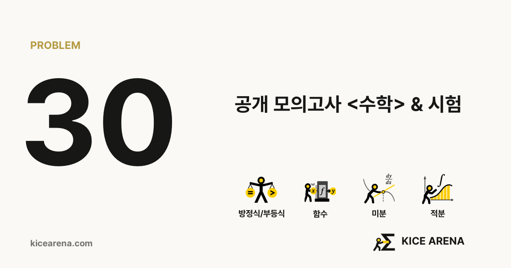
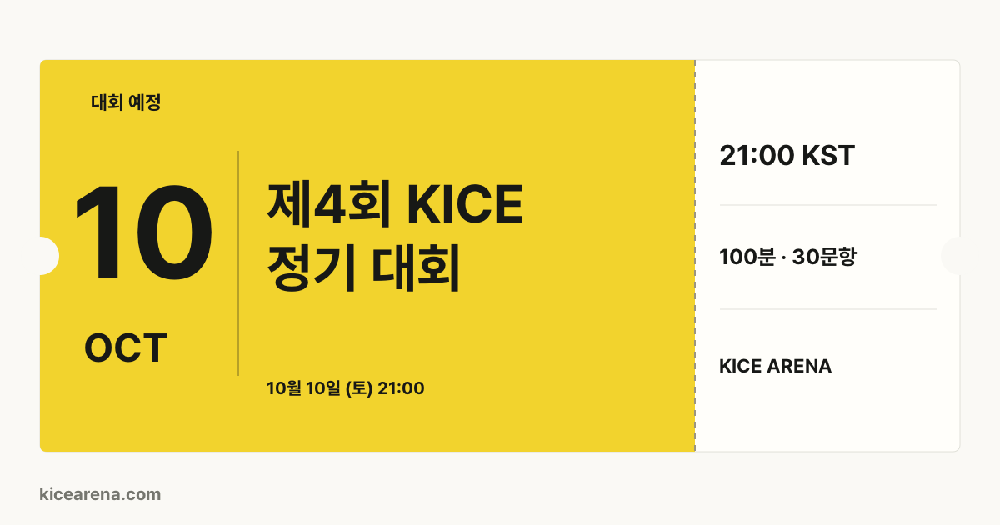

# @kicearena/og-image

Deterministic **1200 × 630 PNG** share cards for site, problem and competition previews.

[MIT](LICENSE) · Node / Bun · ESM + TypeScript




## What it does

- Renders the KICE share-card templates with Sharp, a bundled Korean font and packaged artwork.
- Draws ended-event Mondrian covers using `@kicearena/mondrian`.
- Coalesces identical concurrent renders and bounds the cache to 128 PNGs and four active requests.
- Resolves resources from the installed package, with no application checkout, browser, network assets or database.

## Install and render

Set GitHub Packages scope registry and a read:packages token in `NODE_AUTH_TOKEN`:

```ini
@kicearena:registry=https://npm.pkg.github.com
//npm.pkg.github.com/:_authToken=${NODE_AUTH_TOKEN}
```

```sh
bun add --exact @kicearena/og-image@0.1.0
```

```ts
import {
  renderShareImage,
  createShareImageCache,
  defaultShareImageFile,
} from "@kicearena/og-image";
const imageFor = createShareImageCache(renderShareImage);
const png = await imageFor({
  kind: "problem",
  examTitle: "공개 모의고사",
  number: 30,
  topicTags: [{ label: "미분", icon: "icons/topics/compact/08-derivatives" }],
});
```

Pass already-public display data. Problem cards accept label + asset ID tags. Competition cards accept `variant` (ticket/mondrian), seed, title, status/date/time/summary labels and at most 48 stable unique entry keys. Type declarations describe the complete input. Neither membership, public visibility, event state nor route authorization is decided here.

`warmShareImageRenderer()` prepares the shared resources; render failures are retryable. It configures Fontconfig to the package font directory before lazily loading Sharp. `defaultShareImageFile` is the packaged pre-rendered site card for an inexpensive static response. The HTTP route's deadline, errors, ETags and cache headers belong to the host. Dynamic KICE cards must revalidate public visibility on each request and must not receive immutable CDN caching.

## Develop

```sh
bun install --frozen-lockfile
bun run check
bun run test
bun run build
bun run preview
```

`preview` writes five synthetic example cards. Tests cover deterministic geometry, markup escaping, missing artwork, concurrent capacity, retries, cache invalidation and LRU eviction. Sharp requires its platform-native dependencies; test the target deployment image separately.

## License

[MIT](LICENSE) © 2026 KICE Arena contributors. The bundled Pretendard font retains [SIL OFL 1.1](resources/fonts/LICENSE.txt); see [third-party material](THIRD_PARTY_LICENSES.md).
